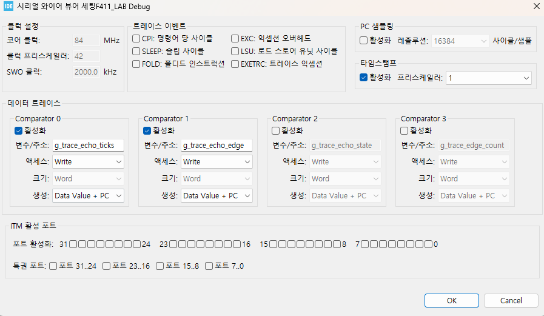

## ultrasonic putty

 ultrasonic putty 

  

---

---
## ultrasonic oscilloscope 

 ultrasonic oscilloscope 

  

- cursor를 시간으로 변경 후 오실로스코프에 나오는 거리의 절반이 실제 ultrasonic sensor와 물체의 거리
  

---

---
## SWV / 트레이스 관찰 

 SWV / 트레이스 관찰 

  
  
  

  

---
