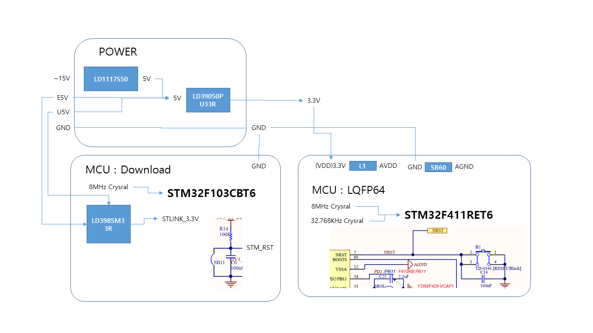
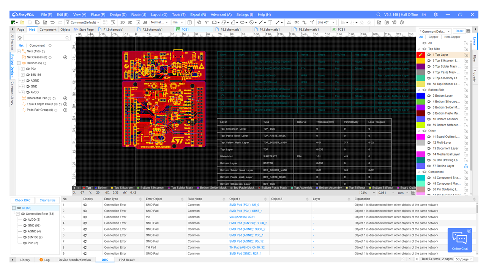
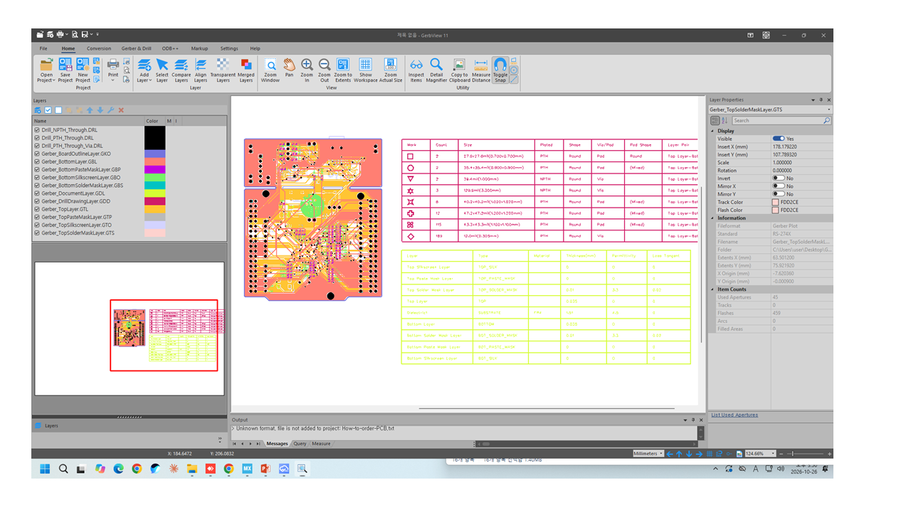
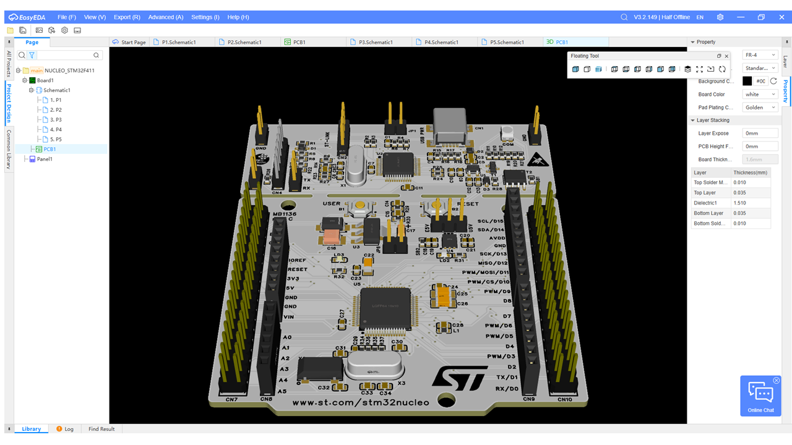
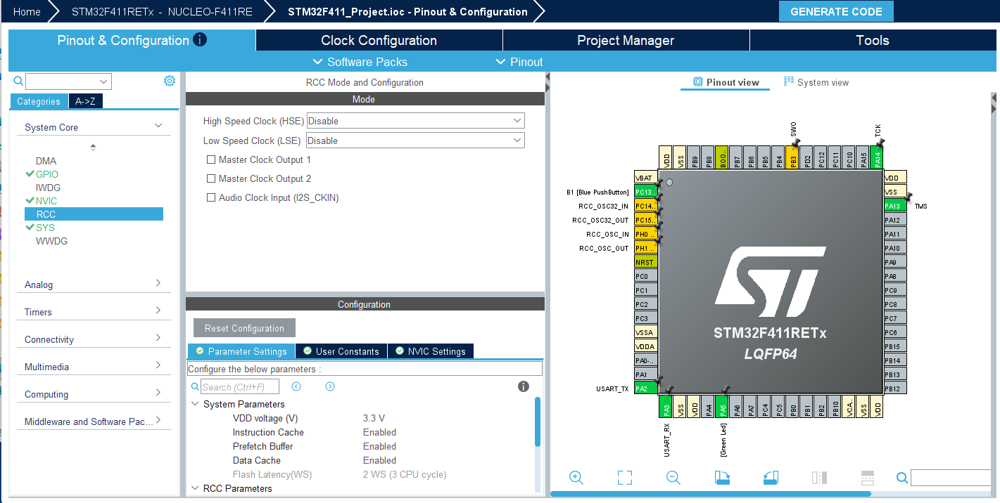
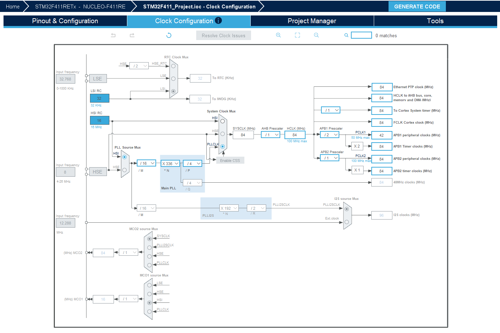
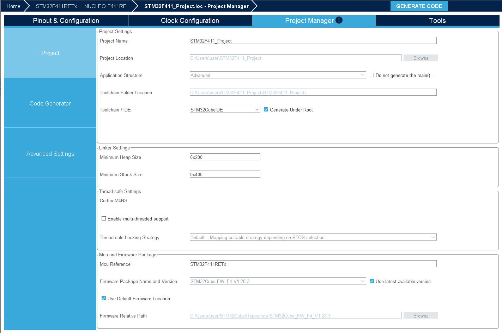

# STM32F411_Project

---

## Hardware






---

## Firmware

- Pinout & Configuration

- Clock Configuration

- Project manager


---
```
/* Infinite loop */
  /* USER CODE BEGIN WHILE */
  while (1)
  {
    /* USER CODE END WHILE */

    /* USER CODE BEGIN 3 */
  }
  /* USER CODE END 3 */
}
```
---
- LD2 1초 Delay
``` /* USER CODE BEGIN WHILE */
  while (1)
  {
    /* USER CODE END WHILE */

    /* USER CODE BEGIN 3 */
	      HAL_GPIO_TogglePin(LD2_GPIO_Port, LD2_Pin);
	      HAL_Delay(1000);
	      /* USER CODE END 3 */
	    }
  }
 ```
--- 
