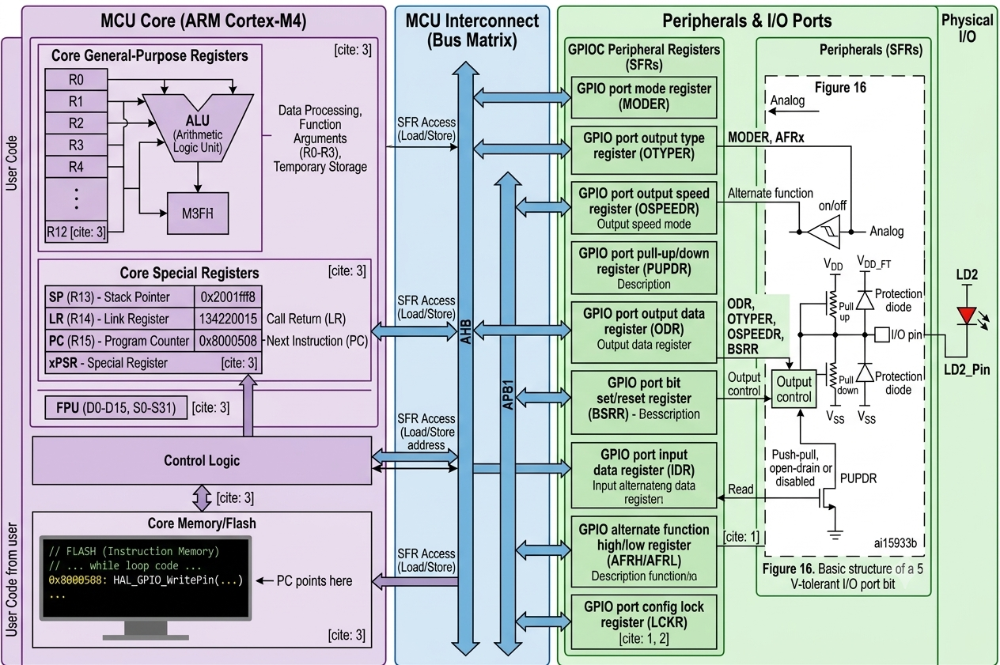
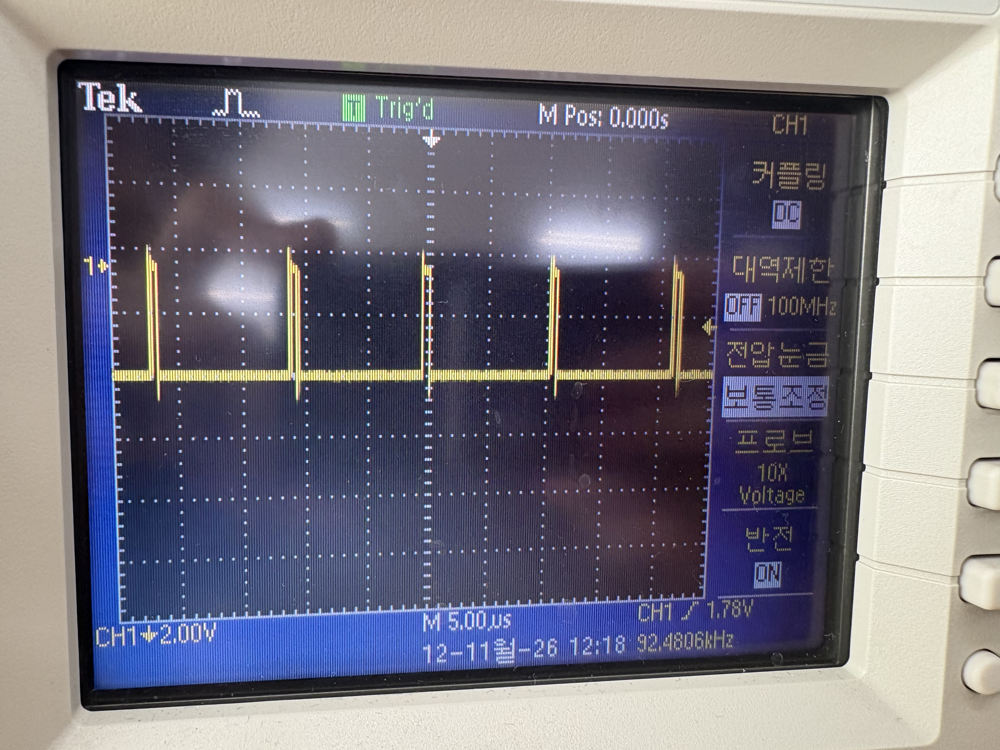
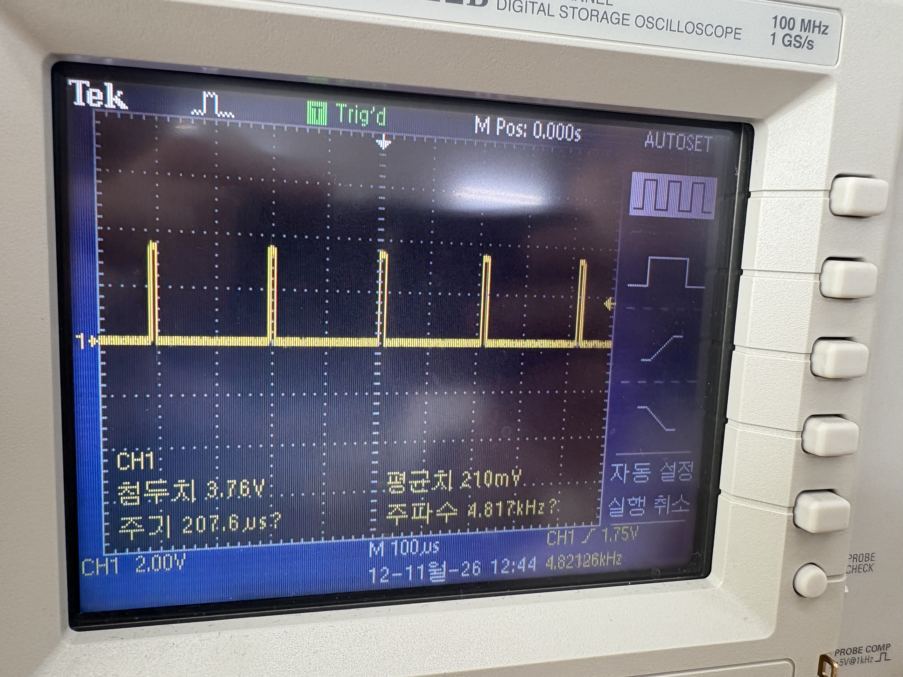
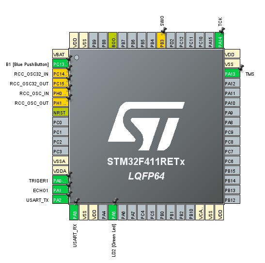
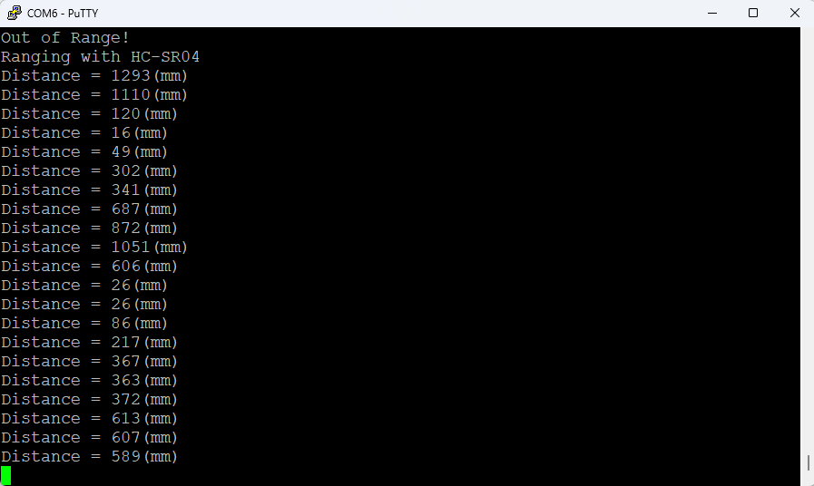

## 5-1 STM32 GPIO 동작 구조 (Cortex-M4 / GPIO → LD2)
<details>

<summary>STM32 동작 구조 </summary>
 <br>


`HAL_GPIO_WritePin()` 호출이 **CPU 코어 → 버스 → GPIO 레지스터 → 물리 핀(LD2)** 까지 어떻게 전달되는지 보여주는 블록 다이어그램 정리입니다.

## 전체 데이터 흐름

```
MCU Core (Cortex-M4) → Bus Matrix (AHB/APB1) → GPIOC 레지스터(SFR) → I/O 포트 회로 → LD2
```

# 1. MCU Core (ARM Cortex-M4)

- **범용 레지스터 (R0~R12)**: ALU 연산, 함수 인자 전달(R0~R3), 임시 저장
- **특수 레지스터**
  - `SP (R13)`: 스택 포인터
  - `LR (R14)`: 함수 복귀 주소
  - `PC (R15)`: 다음에 실행할 명령어 주소
  - `xPSR`: 프로그램 상태 레지스터
- **FPU**: 부동소수점 연산 (D0~D15, S0~S31)
- **Control Logic**: 명령어를 해석해 SFR 접근(Load/Store) 수행
- **Flash 메모리**: 코드 저장. PC가 `0x8000508`의 `HAL_GPIO_WritePin(...)`을 가리킴

# 2. MCU Interconnect (Bus Matrix)

- **AHB**: 고속 메인 버스
- **APB1**: 저속 주변장치용 버스
- 코어는 **Load/Store 명령**으로 SFR(특수 기능 레지스터)에 접근

# 3. GPIOC 주변장치 레지스터 (SFR)

| 레지스터 | 역할 |
|---|---|
| `MODER` | 핀 모드 설정 (입력 / 출력 / 대체기능 / 아날로그) |
| `OTYPER` | 출력 타입 (Push-pull / Open-drain) |
| `OSPEEDR` | 출력 속도 설정 |
| `PUPDR` | 풀업 / 풀다운 저항 설정 |
| `ODR` | 출력 데이터 (핀에 내보낼 값) |
| `BSRR` | 비트 단위 set/reset (원자적 쓰기) |
| `IDR` | 입력 데이터 읽기 |
| `AFRH/AFRL` | 대체 기능(Alternate Function) 선택 |
| `LCKR` | 포트 설정 잠금 |

# 4. I/O 포트 비트 구조 (5V-tolerant)

- **Output control**: ODR/BSRR 값을 받아 출력 구동
- **Push-pull / Open-drain**: OTYPER, PUPDR 설정에 따라 결정
- **풀업 / 풀다운 저항**: VDD / VSS에 연결
- **보호 다이오드**: 과전압 및 ESD로부터 핀 보호
- **Alternate function / Analog 경로**: MODER, AFRx로 선택

# 5. Physical I/O

- 최종 출력은 `LD2_Pin`을 통해 **LD2(LED)** 로 전달

# LED 제어 동작 순서

1. PC가 `HAL_GPIO_WritePin()` 명령어를 가리킴
2. Control Logic이 명령어를 해석 후 SFR 주소로 Store 수행
3. AHB/APB1 버스를 거쳐 GPIOC의 `BSRR`(또는 `ODR`)에 값 기록
4. Output control이 I/O 핀을 구동하여 LD2 ON/OFF

# 핵심 포인트

- `MODER`로 출력 모드를 먼저 설정하고, `ODR`/`BSRR`로 값을 출력
- `BSRR`은 다른 비트에 영향 없이 특정 핀만 안전하게 제어 가능
- 모든 주변장치 제어는 결국 **메모리 맵된 레지스터 읽기/쓰기**
  </details>
---

## 5-2 HC-SR04 
<details>

<summary> HC-SR04 초음파 센서 </summary>

 <br>

 <br>


</details>


---
## 5-3 실습 2
<details>

<summary> HC-SR04 초음파 센서 HAL_Delay / delay_us 차이 비교 </summary>

```c
void trig(void)
{
   HAL_GPIO_WritePin(TRIGER1_GPIO_Port, TRIGER1_Pin, HIGH);
   delay_us(10);
   HAL_GPIO_WritePin(TRIGER1_GPIO_Port, TRIGER1_Pin, LOW);
}
```
```c
 /* USER CODE BEGIN 2 */
  timer_start();
  /* USER CODE END 2 */

  /* Infinite loop */
  /* USER CODE BEGIN WHILE */
  while (1)
  {
	  trig();
	  delay_us(200);
    /* USER CODE END WHILE */

    /* USER CODE BEGIN 3 */
  }
  /* USER CODE END 3 */
}
```
---
HAL_Delay (1) 사용
---
 <br>
- 원하는 주기가 제대로 나오지 않음.
---
---

delay_us(200)으로 변경 후
---
 <br>
- 원하는 주기가 제대로 측정됨.
</details>


---
## 5-4 실습 3
<details>

<summary> HC-SR04 초음파 센서 oscilloscope 거리 비교 </summary>

- 먼저 F411 Board
  
 <br>

- 1. PA0에 초음파 센서 TRIG 연결
- 2. PA1에 초음파 센서 ECHO 연결
- 3. 3.3V에 초음파 센서 VCC 연결
- 4. GND에 초음파 센서 GND 연결
- 5. PA1 왼쪽 핀에 선 하나 더 연결 후 Oscilloscop의 프로브에 연결
- 6. GND를 프로브의 악어클립에 연결 후 오실로스코프 측정

---
- 초음파 센서 거리가 가까울때
  
 <br>

---

---
- 초음파 센서 거리가 멀때
  
 <br>

</details>


## 5-5 실습 4
<details>

<summary> HC-SR04 초음파 센서를 이용한 PUTTY 출력 </summary>

---
- ECHO1 설정을 위해 PA1을 GPIO input으로 pin 설정

 <br>

---

- ECHO1 선언

```c
uint32_t echo(void) {
       uint32_t start_tick, start_time, end_time;

       // ECHO HIGH 대기 (최대 10ms)
       start_tick = HAL_GetTick();
       while (HAL_GPIO_ReadPin(ECHO1_GPIO_Port, ECHO1_Pin) == GPIO_PIN_RESET) {
           if ((HAL_GetTick() - start_tick) > 10) return 0;  // 10ms 초과 → 실패
       }
       start_time = __HAL_TIM_GET_COUNTER(&htim1);

       // ECHO LOW 대기 (최대 30ms = HC-SR04 최대 측정 시간)
       start_tick = HAL_GetTick();
       while (HAL_GPIO_ReadPin(ECHO1_GPIO_Port, ECHO1_Pin) == GPIO_PIN_SET) {
           if ((HAL_GetTick() - start_tick) > 30) return 0;  // 30ms 초과 → 범위 초과
       }
       end_time = __HAL_TIM_GET_COUNTER(&htim1);

       return end_time - start_time;
   }
```
---

- HAL_Delay를 사용해서 PUTTY 화면에 천천히 출력

```c
while (1)
    {
  	  trig();
  	      echo_time = echo();
  	      if( echo_time != 0){
  	          dist = (int)(17 * echo_time / 100);
  	          printf("Distance = %d(mm)\n", dist);
  	      }
  	      else printf("Out of Range!\n");
  	      HAL_Delay(1000);

```

 <br>

</details>


