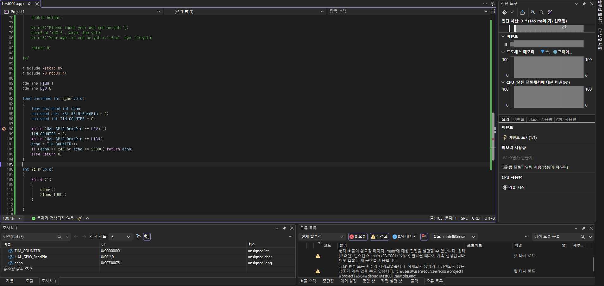
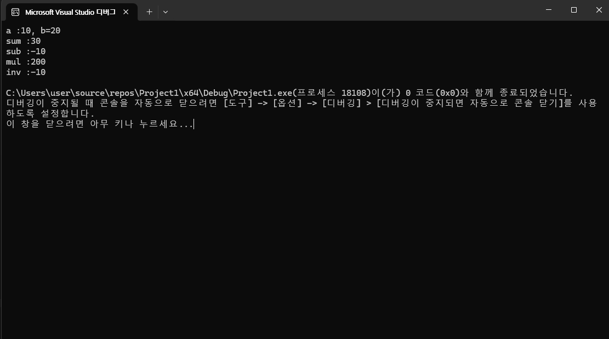
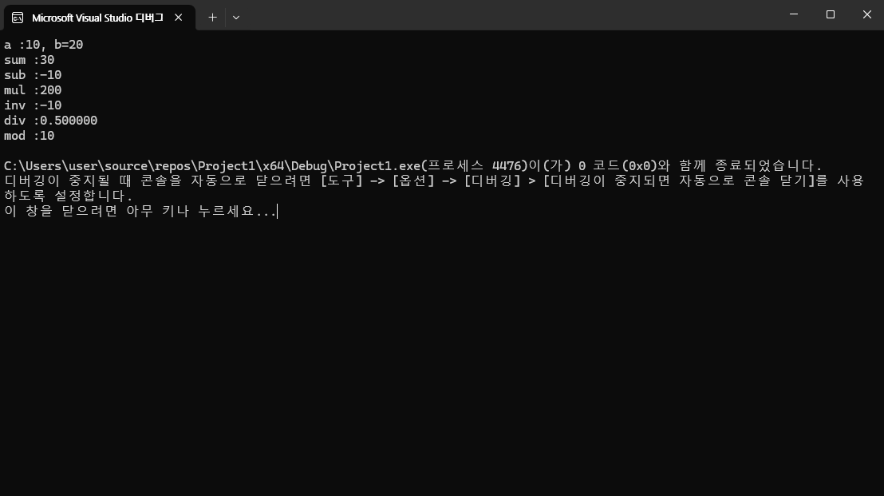
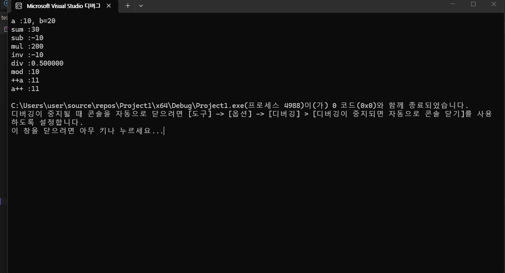
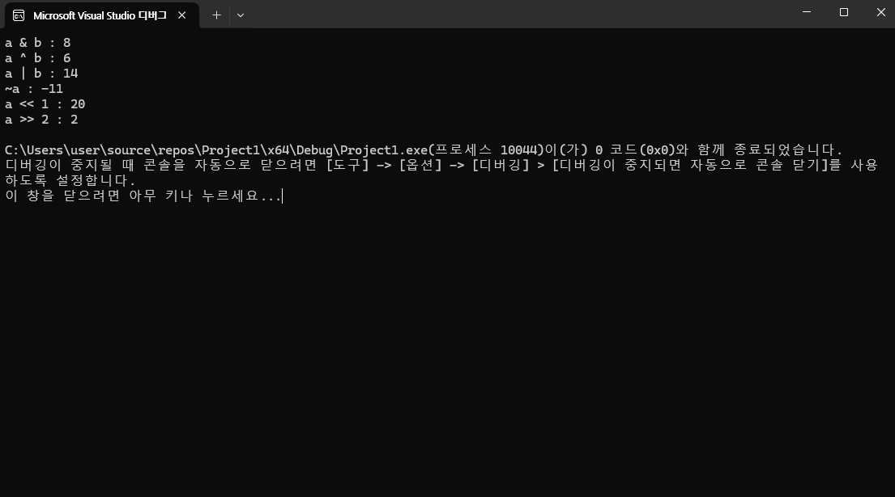
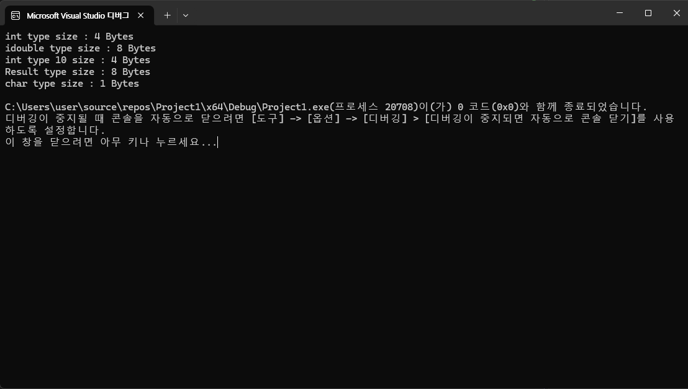
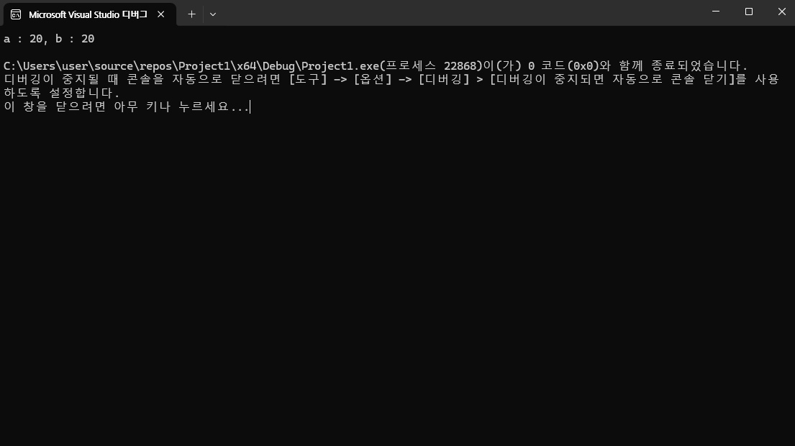

## VS CODE 실습 1
<details>

<summary> VS CODE 실습 1 </summary>

```c
#include <stdio.h>

int add(int a, int b) // a와 b를 더하는 함수
{
    return (a + b);
}

int main(void)
{
    int sum = 0;
    //char text[100] = "Be happy\n";
    //char text[100] = "12345678901234567890\n";
    //char text[100] = "My\tfriend\n";
    char text[100] = "Goot\bd\tchance\n";
    //char text[100] = "Cow\rW\a\n";

    //printf("Be happy");
    printf("%s", text);
    //printf("12345678901234567890\n");
    //printf("My\tfriend\n");
    //printf("Goot\bd\tchance\n");
    //printf("Cow\rW\a\n");

    //sum = add(10, 20);
        return 0;
}
```
 <br>

</details>

---


## VS CODE 실습 2
<details>

<summary> VS CODE 실습 2 </summary>

```c
#include <stdio.h>

int main(void)
{
    printf("%d\n", 10);
    printf("%lf\n", 3.4);
    printf("%.1lf\n", 3.45);
    printf("%.10lf\n", 3.4);

    printf("%d + %d = %d\n", 10, 20, 10 + 20);
    printf("%.1f - %.1f =  %.1f\n", 3.4, 1.2, 3.4 - 1.2);

    return 0;
}
```
 <br>

</details>

---

## VS CODE 실습 3
<details>

<summary> VS CODE 실습 3 </summary>

```c
#include <stdio.h>

int main(void)
{
    int a;

    scanf_s("%d", &a); 
    printf("input : %d\n", a);

    return 0;
}
```
 <br>

</details>

---
---

## VS CODE 실습 4
<details>

<summary> VS CODE 실습 4 </summary>

```c
#include <stdio.h>

int main(void)
{

    int age;
    double height;

    printf("Please input your age and height:");
    scanf_s("%d%lf", &age, &height);
    printf("Your age :%d and height:%.1lfcm", age, height);

    return 0;

}
```
 <br>

</details>

---
## VS CODE 실습 5
<details>

<summary> VS CODE 실습 5 </summary>

```c
#include <stdio.h>
#include <windows.h>

#define HIGH 1
#define LOW 0

long unsigned int echo(void)
{
    long unsigned int echo_val = 0;
    unsigned char HAL_GPIO_ReadPin = 0;
    unsigned int TIM_COUNTER = 0;

    while (HAL_GPIO_ReadPin == LOW) {}   /* 1) 상승(HIGH) 대기 */
    TIM_COUNTER = 0;                        /* 2) 카운터 0 */
    while (HAL_GPIO_ReadPin == HIGH) {    /* 3) 하강(LOW)까지 카운트 */
        TIM_COUNTER++;
    }
    echo_val = TIM_COUNTER;                 /* 4) HIGH 유지 시간(us) */

    if (echo_val >= 240 && echo_val <= 23000) return echo_val;
    return 0;
}
int main(void)
{
    while (1)
    {
        echo();
        //    Sleep(1000);
    }

}
```
 <br>

---

- HAL_GPIO_ReadPin VLAUE 값이 0으로 되어있음.(F10을 눌러도 계속 제자리) --> VALUE 값을 1로 변경하면 F10을 누르면 다음 코드로 넘어감  
</details>

---

---
## VS CODE 실습 6
<details>

<summary> VS CODE 실습 6-1 </summary>

```c
#include <stdio.h>

int main(void)
{
    int a, b;
    int sum, sub, mul, inv;

    a = 10;
    b = 20;
    sum = a + b;
    sub = a - b;
    mul = a * b;
    inv = -a;

    printf("a :%d, b=%d\n", a, b);
    printf("sum :%d\n", sum);
    printf("sub :%d\n", sub);
    printf("mul :%d\n", mul);
    printf("inv :%d\n", inv);

    return 0;
}
```
 <br>

</details>


<details>

<summary> VS CODE 실습 6-2 </summary>

```c
#include <stdio.h>

int main(void)
{
    int a, b;
    int sum, sub, mul, inv, mod;
    float div;

    a = 10;
    b = 20;
    sum = a + b;
    sub = a - b;
    mul = a * b;
    div = (float)a / b;
    mod = a % b;
    inv = -a;

    printf("a :%d, b=%d\n", a, b);
    printf("sum :%d\n", sum);
    printf("sub :%d\n", sub);
    printf("mul :%d\n", mul);
    printf("inv :%d\n", inv);
    printf("div :%f\n", div);
    printf("mod :%d\n", mod);


    return 0;
}
```
 <br>

- int(정수) 대신 float(실수)을 이용하기 위해 float 사용 
</details>


<details>

<summary> VS CODE 실습 6-3 </summary>

```c
#include <stdio.h>

int main(void)
{
    int a, b;
    int sum, sub, mul, inv, mod;
    float div;

    a = 10;
    b = 20;
    sum = a + b;
    sub = a - b;
    mul = a * b;
    div = (float)a / b;
    mod = a % b;
    inv = -a;

    printf("a :%d, b=%d\n", a, b);
    printf("sum :%d\n", sum);
    printf("sub :%d\n", sub);
    printf("mul :%d\n", mul);
    printf("inv :%d\n", inv);
    printf("div :%f\n", div);
    printf("mod :%d\n", mod);

    printf("++a :%d\n", ++a);
    printf("a++ :%d\n", a++);

    return 0;
}
```
 <br>

</details>


## VS CODE 연산자 정리
<details>

<summary> VS CODE 연산자 정리 </summary>

 <br>

 <br>

 <br>
</details>

---
## VS CODE 실습 7
<details>

<summary> VS CODE 실습 7 </summary>

```c
#include <stdio.h>

int main(void)
{
    int a = 10;
    int b = 12;

    printf("a & b : %d\n", a & b);
    printf("a ^ b : %d\n", a ^ b);
    printf("a | b : %d\n", a | b);
    printf("~a : %d\n", ~a);
    printf("a << 1 : %d\n", a << 1);
    printf("a >> 2 : %d\n", a >> 2);

    return 0;
}
```
 <br>

</details>

---

## VS CODE 실습 8
<details>

<summary> VS CODE 실습 8 </summary>

```c
#include <stdio.h>

int main(void)
{

    int a = 10;
    double b = 3.4;

    printf("int type size : %d Bytes\n", sizeof(a));
    printf("idouble type size : %d Bytes\n", sizeof(b));
    printf("int type 10 size : %d Bytes\n", sizeof(10));
    printf("Result type size : %d Bytes\n", sizeof(1.5 + 3.4));
    printf("char type size : %d Bytes\n", sizeof(char));

    return 0;
}
```
 <br>

</details>

---

## VS CODE 실습 9
<details>

<summary> VS CODE 실습 9 </summary>

```c
#include <stdio.h>

int main(void)
{
    int a = 20;
    int b = 0;

    if (a > 10)
    {
        b = a;
    }

    printf("a : %d, b : %d\n", a, b);

    return 0;
}
```
 <br>

</details>

---
## VS CODE 과제 
<details>

<summary> Rising Edge 검출 / Falling Edage 검출 코드 </summary>

```c
#include <stdio.h>

int main(void)
{
    int a = 0; 
    int b = 0;

    while (1)
    {
        printf("signal input (0 or 1, end -1) : ");
        scanf_s("%d", &b);

        if (b == -1)
        {
            break;
        }

        if (a == 0 && b == 1)
        {
            printf("--> rising edge (0 -> 1)\n");
        }

        else if (a == 1 && b == 0)
        {
            printf("--> falling edge (1 -> 0)\n");
        }

        else
        {
            printf("--> no signal  (%d -> %d)\n", a, b);
        }

        a = b;

    }

    return 0;
}
```


 <br>

- 처음은 0에서 시작 1로 올라가면 rising edge, 1인 상태에서 0을 입력하면 falling edge, -1 입력하면 종료, 0인 상태에서 0을 입력하면(상태 변화가 없을때) no signal 반대도 마찬가지 1인 상태에서 1을 입력하면 동일함.
- 마지막 a = b; 이 코드는 입력한 상태 유지
</details>
