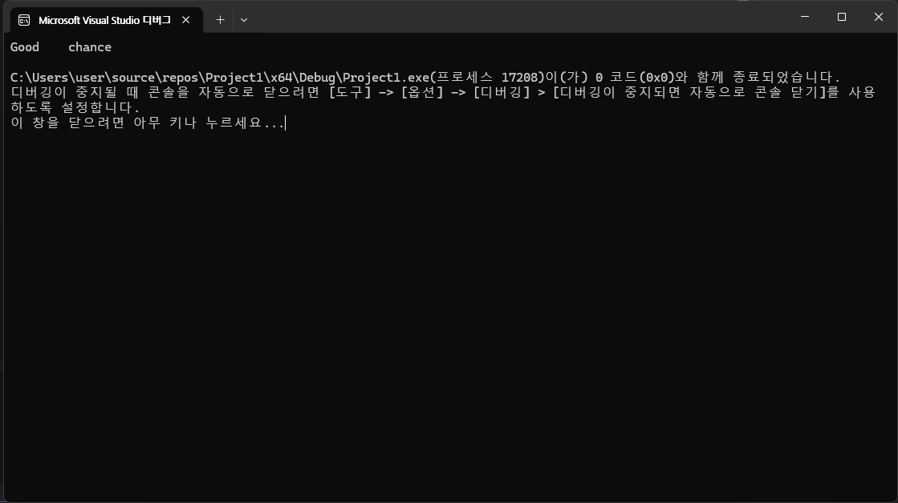
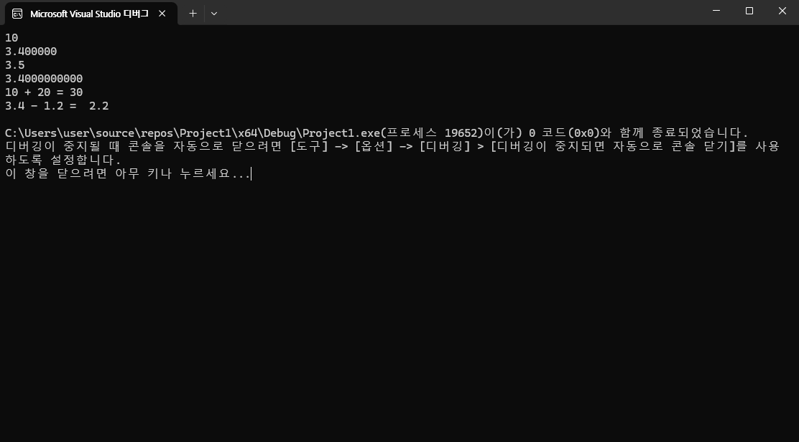
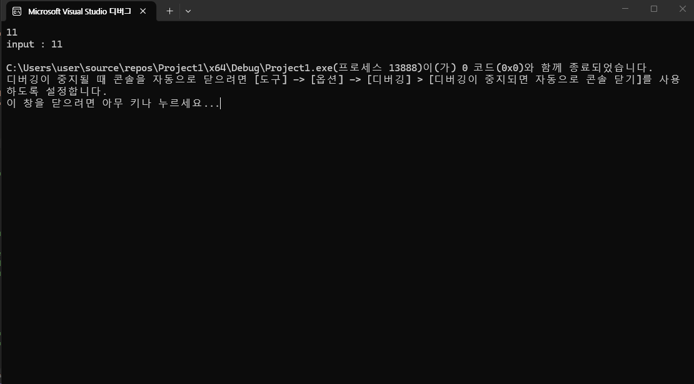
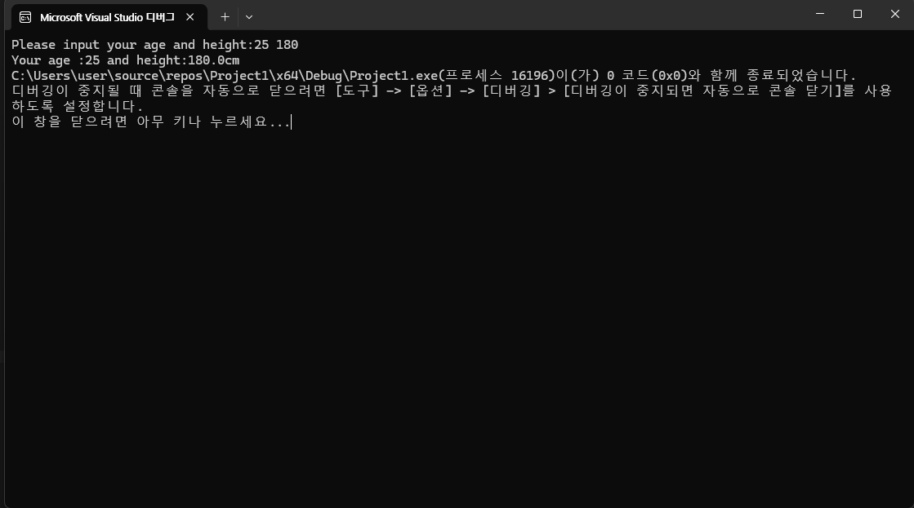

## VS CODE 실습 1
<details>

<summary> VS CODE 실습 1 </summary>

```c
#include <stdio.h>

int add(int a, int b) // a와 b를 더하는 함수
{
    return (a + b);
}

int main(void)
{
    int sum = 0;
    //char text[100] = "Be happy\n";
    //char text[100] = "12345678901234567890\n";
    //char text[100] = "My\tfriend\n";
    char text[100] = "Goot\bd\tchance\n";
    //char text[100] = "Cow\rW\a\n";

    //printf("Be happy");
    printf("%s", text);
    //printf("12345678901234567890\n");
    //printf("My\tfriend\n");
    //printf("Goot\bd\tchance\n");
    //printf("Cow\rW\a\n");

    //sum = add(10, 20);
        return 0;
}
```
 <br>

</details>

---


## VS CODE 실습 2
<details>

<summary> VS CODE 실습 2 </summary>

```c
#include <stdio.h>

int main(void)
{
    printf("%d\n", 10);
    printf("%lf\n", 3.4);
    printf("%.1lf\n", 3.45);
    printf("%.10lf\n", 3.4);

    printf("%d + %d = %d\n", 10, 20, 10 + 20);
    printf("%.1f - %.1f =  %.1f\n", 3.4, 1.2, 3.4 - 1.2);

    return 0;
}
```
 <br>

</details>

---

## VS CODE 실습 3
<details>

<summary> VS CODE 실습 3 </summary>

```c
#include <stdio.h>

int main(void)
{
    int a;

    scanf_s("%d", &a); 
    printf("input : %d\n", a);

    return 0;
}
```
 <br>

</details>

---
---

## VS CODE 실습 4
<details>

<summary> VS CODE 실습 4 </summary>

```c
#include <stdio.h>

int main(void)
{

    int age;
    double height;

    printf("Please input your age and height:");
    scanf_s("%d%lf", &age, &height);
    printf("Your age :%d and height:%.1lfcm", age, height);

    return 0;

}
```
 <br>

</details>

---
## VS CODE 실습 5
<details>

<summary> VS CODE 실습 5 </summary>

```c
#include <stdio.h>
#include <windows.h>

#define HIGH 1
#define LOW 0

long unsigned int echo(void)
{
    long unsigned int echo_val = 0;
    unsigned char HAL_GPIO_ReadPin = 0;
    unsigned int TIM_COUNTER = 0;

    while (HAL_GPIO_ReadPin == LOW) {}   /* 1) 상승(HIGH) 대기 */
    TIM_COUNTER = 0;                        /* 2) 카운터 0 */
    while (HAL_GPIO_ReadPin == HIGH) {    /* 3) 하강(LOW)까지 카운트 */
        TIM_COUNTER++;
    }
    echo_val = TIM_COUNTER;                 /* 4) HIGH 유지 시간(us) */

    if (echo_val >= 240 && echo_val <= 23000) return echo_val;
    return 0;
}
int main(void)
{
    while (1)
    {
        echo();
        //    Sleep(1000);
    }

}
```
 <br>

</details>

---
