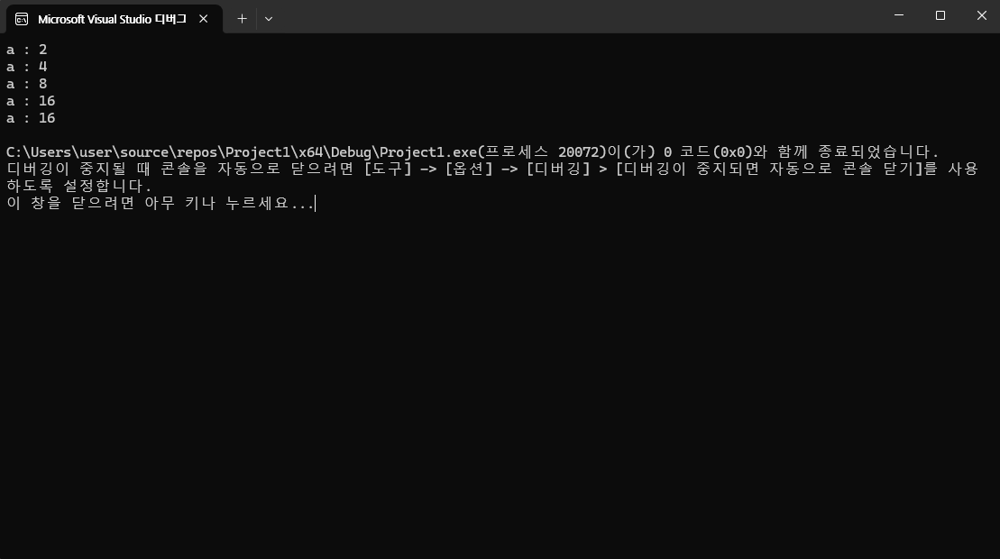
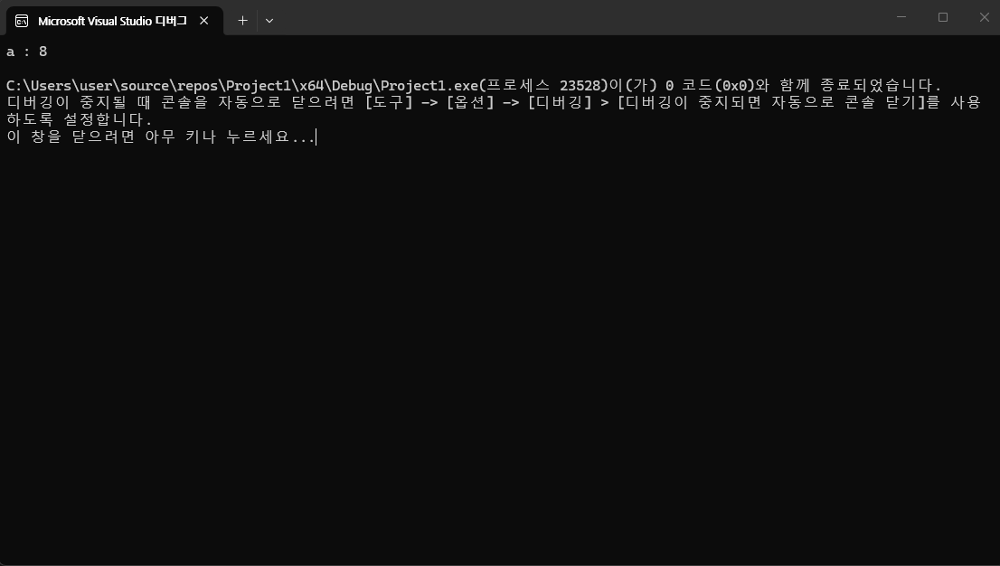
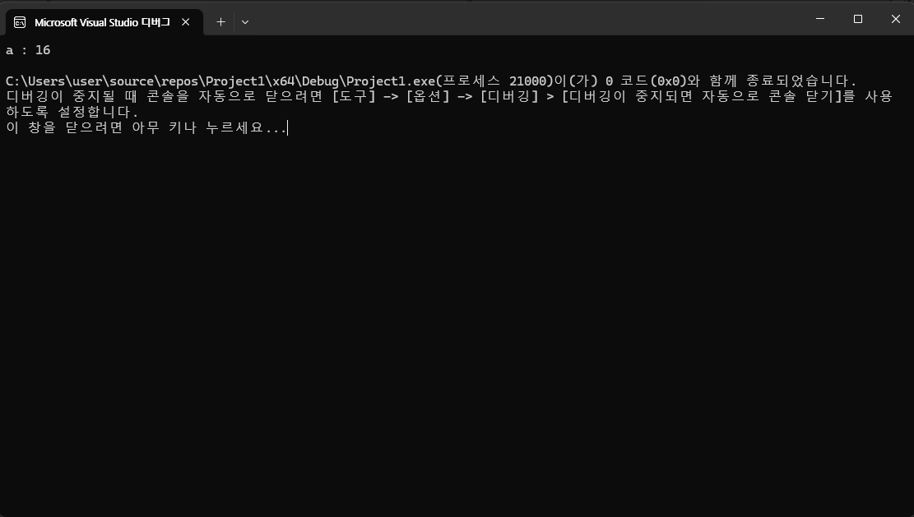
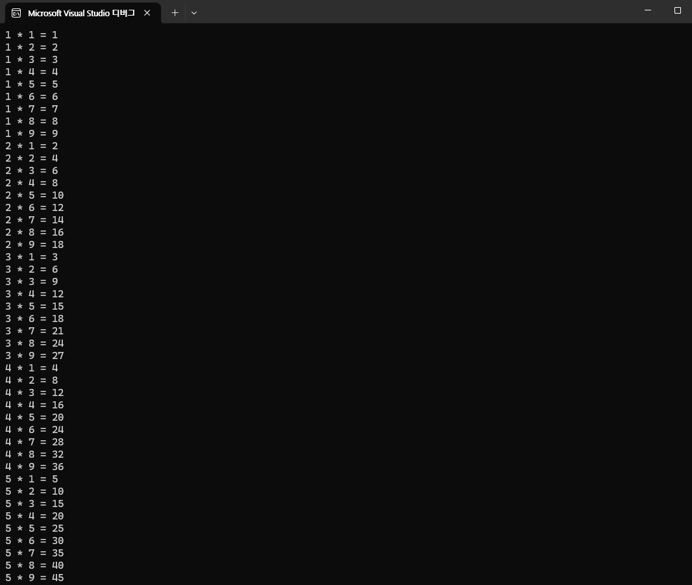
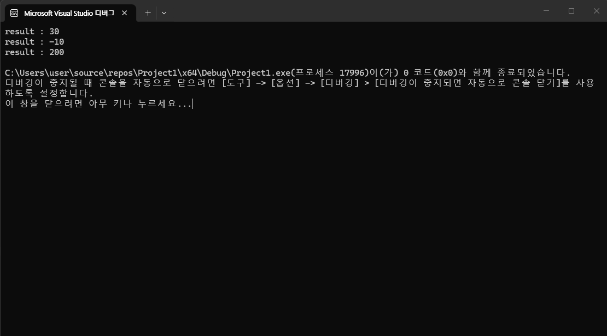

## VS CODE While 반복문
<details>

<summary> VS CODE while 반복문 </summary>

```c
#include <stdio.h>

int main(void)
{
    int a = 1;

    while (a < 10)
    {
        a = a * 2;
        printf("a : %d\n", a);
    }

    printf("a : %d\n", a);

    return 0;

}
```
 <br>

</details>

---

---

## VS CODE for 반복문
<details>

<summary> VS CODE for 반복문 </summary>

```c
#include <stdio.h>

int main(void)
{
    int a = 1;
    int i;

    for (i = 0; i < 3; i++)
    {
        a = a * 2;
    }
    printf("a : %d\n", a);

    return 0;
}
```
 <br>

</details>

---

---

## VS CODE do ~ while 반복문
<details>

<summary> VS CODE do ~ while 반복문 </summary>

```c
#include <stdio.h>

int main(void)
{
    int a = 1;

    do
    {
        a = a * 2;
    } while (a < 10);
    printf("a : %d\n", a);

    return 0;
}
```
 <br>

</details>

---

---

## VS CODE for 문 중첩
<details>

<summary> VS CODE for 문 중첩 </summary>

```c
#include <stdio.h>

int main(void)
{
    for (int a = 1; a < 10; a++) {
        for (int b = 1; b < 10; b++) {
            printf("%d * %d = %d\n", a, b, a * b);
        }
    }
    return 0;
}
```
 <br>
 <br>

</details>

---

---

## VS CODE 함수문
<details>

<summary> VS CODE 함수문 </summary>

```c
#include <stdio.h>

int sum(int x, int y);
int sub(int x, int y);
int mul(int x, int y);

int main(void)
{
    int a = 10, b = 20;
    int result;

    result = sum(10, 20);
    printf("result : %d\n", result);
    result = sub(10, 20);
    printf("result : %d\n", result);
    result = mul(10, 20);
    printf("result : %d\n", result);
    return 0;
}

int sum(int x, int y)
{
    int temp;
    temp = x + y;
    return temp;

}
int sub(int x, int y)
{
    int temp;
    temp = x - y;
    return temp;

}
int mul(int x, int y)
{
    int temp;
    temp = x * y;
    return temp;

}
```
 <br>

</details>

---

